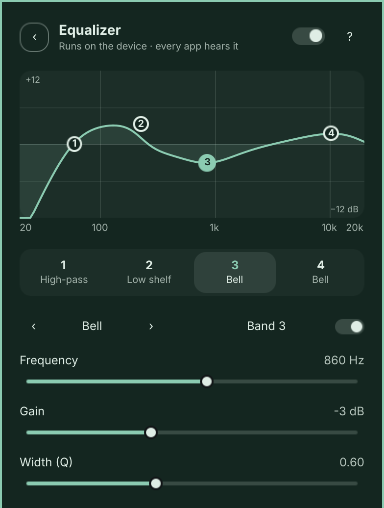
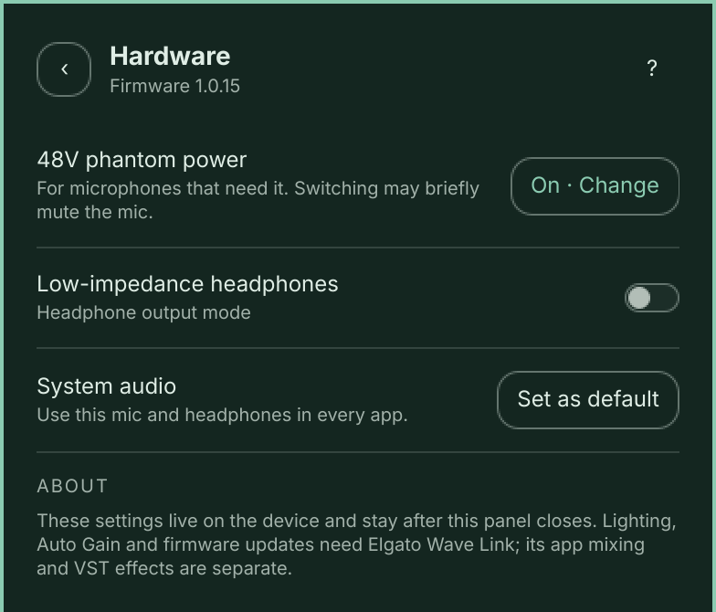

# Elgato Wave XLR MK.2 for Omarchy


Control the **Elgato Wave XLR MK.2** (also written Wave XLR MK2) from the
Omarchy bar on Linux: microphone gain, mute, headphones, monitor mix, the
onboard effects and the unit's four-band hardware EQ. Wave Link is
Windows/macOS only; this plugin covers the settings stored on the device
itself, so they keep working in every app without a host-side mixer.

It supports the MK.2 only (USB 0fd9:00b6), not the original Wave XLR, Wave XLR
Pro or Stream Deck XLR Dock.

<table>
  <tr>
    <td></td>
    <td></td>
    <td></td>
  </tr>
  <tr><td>Controls</td><td>Equalizer</td><td>Hardware</td></tr>
</table>

A device icon sits beside the stock audio control. It follows the bar color,
dims when the device is unavailable, and turns the theme's urgent color with a
slash when muted. The panel follows the live Omarchy theme, font, spacing and
scale.

## Features

**Controls page**
- Mic gain 0–80 dB (the real preamp gain), hardware mute, headphone level
  −60 to 0 dB, and the direct-monitor mix between mic and computer.
- Onboard processing: Clipguard, low cut, expander, compressor, and Voice Tune
  with its strength.

**Equalizer** (firmware 1.0.15 or later): the four-band EQ that Wave Link runs
on the unit's own processor.
- Master switch; per band: on/off, type (high-pass, low shelf, bell, notch,
  high shelf, low-pass), 20 Hz–20 kHz, ±12 dB in 0.25 dB steps, and Q 0.1–10.
- A graph of the combined response (RBJ biquads at 48 kHz). Drag a band's
  point to set frequency and gain; scroll over it to change Q.
- Band tabs choose which band the sliders edit. Frequency and Q sliders are
  logarithmic; arrows and the wheel step 1/12 octave or one device Q step.
  Types without gain hide the gain slider.
- Bands set in Wave Link are shown and kept. Wave Link leaves the EQ running
  when it quits, so a unit last used on Windows or macOS may arrive with it on.

**Hardware page**: 48V phantom power (with a confirmation step, Cancel
focused first), low-impedance headphone mode, a "Set as default" action for
system audio, and the firmware version. Loading the plugin never changes
defaults or hardware settings on its own.

**Keyboard and mouse**
- Tab/Shift-Tab move between controls; arrows adjust sliders. Gain steps 1 dB,
  headphones 0.25 dB.
- The wheel steps headphones by 1 dB; Shift-wheel by 0.25 dB.
- M toggles mute. Escape cancels a confirmation, goes back a page, or closes.
- "?" opens help. Values are settings, not level meters.

**Not implemented**: compressor/expander parameters (threshold, ratio, attack,
release — their byte layout is only inferred from the Wave:3 MK.2), LED
customization, Auto Gain, gain lock, firmware updates, Wave Link's app mixing
and VST hosting.

## Installation

Runtime: libusb, systemd/libudev, ALSA tools, PipeWire/WirePlumber, and
Omarchy's Quickshell shell (this is not a Waybar module). Build: Rust/Cargo, a
C compiler and pkg-config. Python is not needed.

```bash
omarchy pkg add rust base-devel pkgconf libusb alsa-utils
omarchy plugin add https://github.com/sud0n1m/omarchy-wave-xlr-mk2
~/.config/omarchy/plugins/sudonim.wave-xlr/build-worker
omarchy plugin enable sudonim.wave-xlr
```

`build-worker` runs `cargo build --release --locked` and installs the native
worker in the plugin's `libexec/`. Build output is cached in
`~/.cache/omarchy-wave-xlr-mk2/build` (respects `XDG_CACHE_HOME`). Nothing is
compiled or downloaded at runtime, and building needs no root.

Optional placement and a connection check:

```bash
omarchy bar put sudonim.wave-xlr --before omarchy.audio
omarchy restart shell
omarchy-shell sudonim.wave-xlr-status status
```

Status should report `usb: true`, `stale: false`, a running worker and no
error. The shell owns the worker; no systemd unit is needed. Do not install
the MK.1 WirePlumber workaround for the MK.2.

To update:

```bash
omarchy plugin update sudonim.wave-xlr
~/.config/omarchy/plugins/sudonim.wave-xlr/build-worker
omarchy restart shell
```

### USB access

Gain, mute and headphones work through ALSA without extra permissions. The
onboard effects, EQ, monitor mix and hardware settings need access to the
device's vendor USB interface. Grant it with the plugin's own setup command,
run in a terminal (it asks for your password itself; do **not** prefix it
with `sudo`):

```bash
~/.config/omarchy/plugins/sudonim.wave-xlr/libexec/wave-xlr-control --install-udev-rule
sudo udevadm control --reload-rules
```

Then reconnect the MK.2. The rule gives the active local user access to this
product only.

<details>
<summary>How the setup command stays safe</summary>

The unprivileged helper hashes its running executable through
`/proc/<pid>/exe` before the password prompt and invokes only the system
`sudo` and `bash`, with a literal bootstrap supplied before authentication.
System tools copy the executable to a private root-owned directory, verify its
SHA-256 against the pre-prompt digest, and run that copy. A changed copy is
rejected; the user-writable checkout is never executed as root, and the
private copy is removed on exit.

It creates `/etc/udev/rules.d/70-sudonim-wave-xlr-mk2.rules` atomically,
without overwriting any existing path. A root-only `.sudonim-wave-xlr-mk2/`
directory beside it records ownership with a hard link to the installed inode.
Re-running setup accepts only that exact inode with unchanged contents, owner
and permissions. Existing files (even identical ones), symlinks, modified
rules and replacements are left alone and reported as conflicts. The helper
does not touch the USB device.

**Upgrading from 1.2.1 or earlier:** the old `70-wave-xlr-mk2.rules` is left
untouched because its ownership can't be established. It can keep providing
access; review its origin before removing it.
</details>

## Removal

If you installed this version's USB rule and nothing else needs it, remove it
**before** removing the plugin (the helper is part of the plugin):

```bash
~/.config/omarchy/plugins/sudonim.wave-xlr/libexec/wave-xlr-control --remove-udev-rule
sudo udevadm control --reload-rules
omarchy plugin remove sudonim.wave-xlr
```

Removal requires the original inode plus a matching receipt, contents, owner
and permissions, and refuses to delete an unowned, modified, replaced or
symlinked rule. Don't bypass a refusal with `rm`. The empty ownership
directory and setup lock stay behind; neither grants access. Reconnect the
device to apply the change. Hardware settings and any PipeWire defaults you
chose are left as they are.

## How it works

One persistent Rust worker owns the vendor USB interface and talks to the
panel in newline-delimited JSON over stdin/stdout. It claims only that
interface; the kernel's audio driver keeps the streaming interfaces.

**Event-driven, idle at zero.** The MK.2 reports gain, mute and headphone
changes (knob, mute button or any other program) on its audio-control
interrupt endpoint, and the kernel turns them into ALSA control events. The
worker subscribes to them directly (no libasound) and re-reads only the
reported block, so a change reaches the bar in about 3 ms. With the panel
closed it does nothing until the device, a command or a USB plug event wakes
it: no polling, no heartbeat, 0 wakeups per second (v1.2.3 woke about 9 times
a second). While the panel is open it also reads the two blocks the dial can
change without an event (monitor mix, Voice Tune strength) every 50 ms, and
every block every 5 s. Without access to the sound card's events it falls
back to reading every block every 50 ms (open) or 500 ms (closed). When the
device is unplugged, the worker sleeps on udev until it returns.

**Small updates.** Full state is sent on `poll`, `refresh`, reconnection and
errors; otherwise only changed fields are sent as a `patch`. An unchanged USB
read is not decoded. Writes read, modify and read back only the target block
(3 USB transfers).

**Responsive editing.** Drags display immediately, write at most every 50 ms
and always send the final value. Pending request IDs keep older
acknowledgments from overwriting newer edits. Changes made on the device
briefly highlight the affected value.

**Failure handling.** Stale values are marked and editing is disabled. The
shell restarts a worker that stops responding: 3 s without a frame, or 12 s
during "Set as default". While the panel is closed and the worker is idle on
events, its frames say `"quiet": true` and the shell expects nothing until a
command is outstanding. USB transfers time out after 1 s, so an idle worker
can't hang unnoticed. Reconnection uses backoff and never replays writes.
Without vendor USB permission, gain, mute and headphones fall back to ALSA.
Only one worker can hold the lock, so the standalone CLI refuses to run while
the bar's worker is running. Multiple bar instances are not supported yet.

Diagnostics while the bar is running:

```bash
omarchy-shell sudonim.wave-xlr-status status
```

`libexec/wave-xlr-control` also works standalone when the plugin is disabled.
Don't run another vendor-control app at the same time.

Measurements: [v1.3.0: EQ, events and quiet idle](docs/hardware-eq-efficiency.md),
[v1.2.1: unplugged idle](docs/event-only-idle.md),
[Rust migration](docs/rust-migration.md), [earlier Python review](docs/efficiency.md).
Physical-knob-to-screen latency and acoustic DSP quality have not been measured.

## Protocol and safety

These are community protocol mappings, not an Elgato Linux API. Reference:
[OpenXLR `WaveXlrMk2Device.cs`](https://github.com/emaspa/openxlr/blob/main/src/OpenXLR.Core/Devices/WaveXlrMk2Device.cs)
and the [OpenXLR MK.2 EQ findings](https://github.com/emaspa/openxlr/blob/main/docs/mk2-eq-findings.md).

- Interface 3, bank 0x0203, blocks 1, 4 and 5 (6, 38 and 2 bytes).
- Block 0 (117 bytes) is read once per connection; bytes 5–7 are the firmware
  version.
- From firmware 1.0.15, block 4 also holds the EQ. Byte 2 bit 0 is the master
  switch. Four 5-byte bands start at byte 18: flags (bit 0 on, bits 1–3 the
  type), int8 gain in quarter dB, uint16 LE frequency, and int8 Q as
  round(64·log10 Q).
- EQ controls appear only when the firmware is new enough and every band
  decodes within Wave Link's ranges. Otherwise the state reports
  `eqUnavailable` (`firmwareOld`, `firmwareUnknown` or `unsupportedBlock`) and
  EQ writes are refused before any USB transfer.
- Every write reads the current block, changes only the chosen field,
  preserves unknown bytes and bits (including band flag bits 4–7), and
  confirms the value by reading it back. Unexpected lengths or ranges fail
  closed. Readback confirms the register, not how the processing sounds.

## Development

```bash
cargo test --locked
cargo clippy --locked --all-targets -- -D warnings
cargo fmt --check
# UI tests: need Node.js, Omarchy's Quickshell and QtTest
cargo test --locked --test panel -- --ignored --nocapture
```

The Rust tests use fake devices and clocks and never write to real hardware.
They cover byte preservation (every EQ field against every other byte and
bit), Q encoding for all 129 device values, the firmware gate and corrupt
bands, bounds, readback, reconnects, ALSA fallback, stale state, idle
deadlines and quiet mode. Framing and subprocess tests cover oversized or
invalid input, timeout cleanup and large output. Setup tests cover rule
ownership, collisions, modified or replaced rules, symlinks, permissions,
concurrent and interrupted setup, and the hashed staging of the privileged
copy, all in temporary directories without administrator access.

The UI tests run functions and components extracted from the real
`Panel.qml`: state handling and watchdog behavior, slider and EQ graph
gestures in an offscreen shell, and the EQ response math against known filter
values (bell peak, −3 dB cutoffs, shelf plateaus, notch depth). They never
start the device worker and are ignored by default so the worker suite runs
without desktop dependencies.

The original Python implementation is in Git history; the current source and
tests contain no Python.

## License and acknowledgments

[MIT](LICENSE). Thanks to [OpenXLR](https://github.com/emaspa/openxlr) for
documenting the Wave XLR MK.2 USB protocol. This project implements those
mappings in its own worker and does not bundle or run OpenXLR. The device
icon is original artwork for this plugin. Not affiliated with Elgato.
